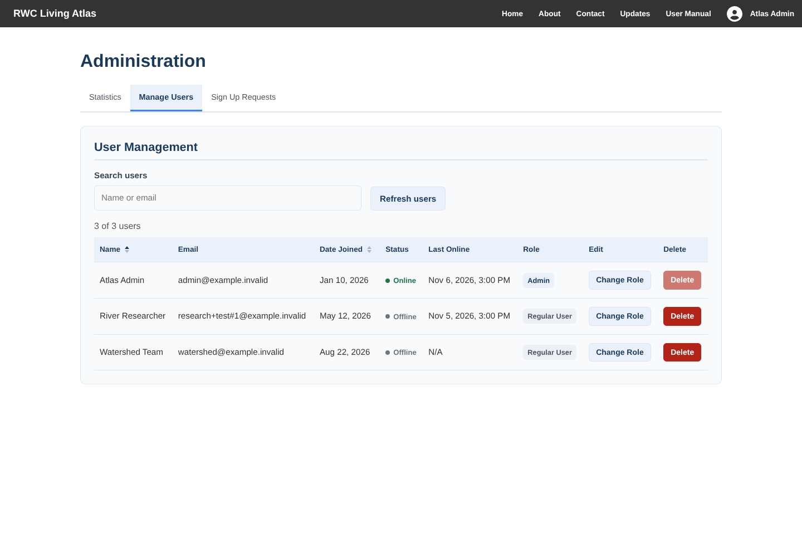
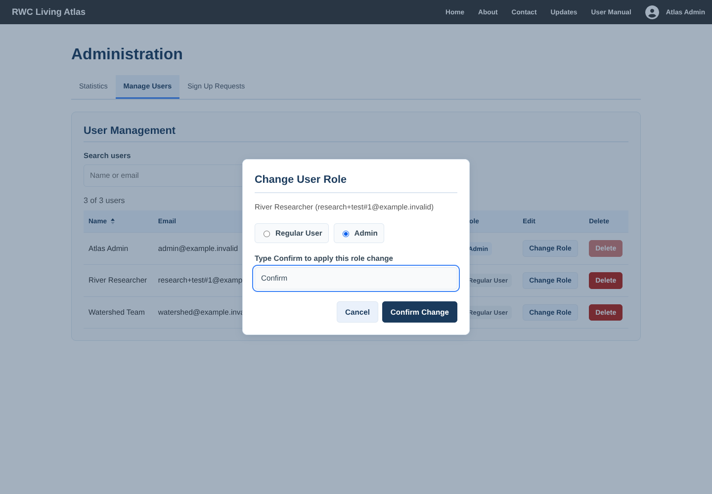
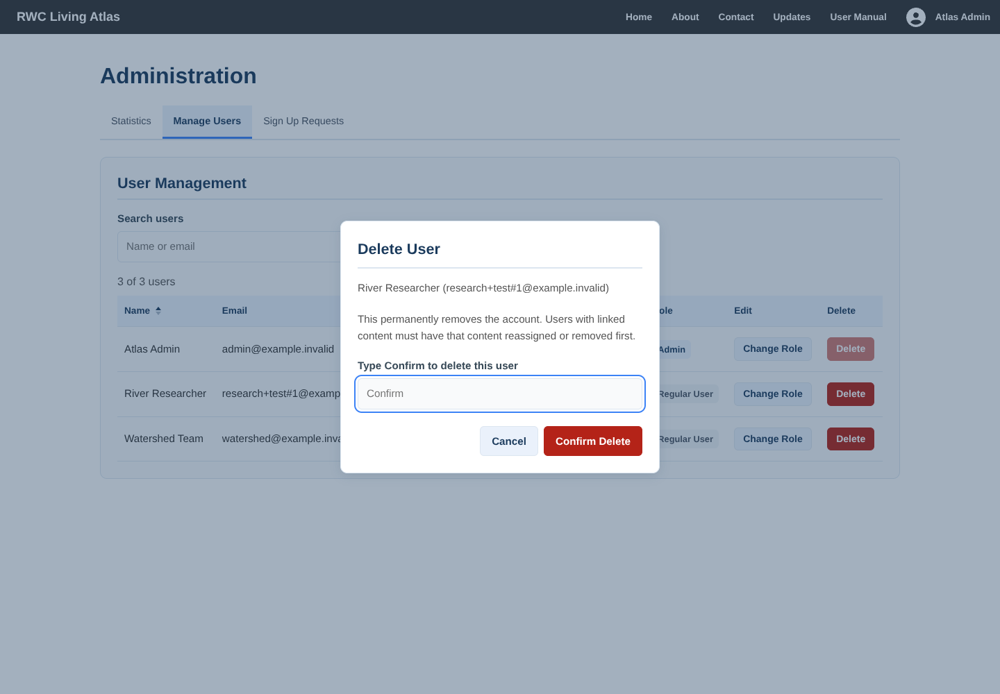
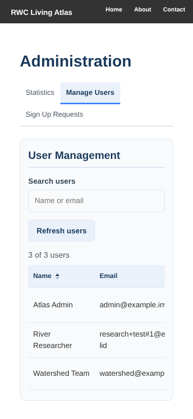
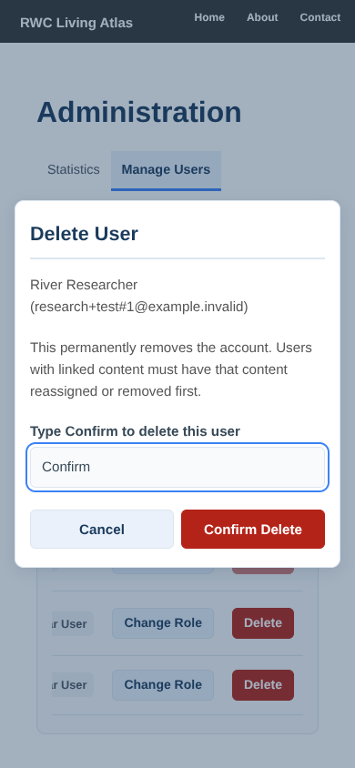

# User Management verification

The dashboard restores stored login state before evaluating protected routes. Manage Users opens by default and includes search, refresh, counts, loading/error states, and keyboard-accessible sorting. Role changes and deletions keep failures visible, prevent duplicate submissions, update successful results immediately, and use accessible confirmation dialogs.

Management APIs use independent transactions with rollback and return HTTP errors for missing users, protected admins, linked content, and database failures. Concurrent role changes cannot remove the last admin. A current user's role change also updates their browser session.

## Validation

- Frontend regression: 31 suites / 214 tests passed, including 13 new auth and management cases.
- Backend offline regression: 67 tests passed, including 11 new management API cases.
- Isolated PostgreSQL 17: 5 integration tests passed, including persisted role changes, concurrent demotions, deletion conflicts, and transaction recovery.
- Repository helper regressions: 30 tests passed.
- Manual export contracts and production build passed (existing lint warnings).
- Chromium checks using the production bundle and synthetic API responses: reload remains on `/administration`; promote/demote updates the selected row; Enter submits; Escape cancels and restores focus; deletion encodes special email characters; a 390px viewport keeps the admin panel within the viewport and scrolls the table horizontally; dialogs remain usable; no page errors.

The browser checks use synthetic `example.invalid` users and intercept remote requests. Database checks use a separate disposable local PostgreSQL cluster. No production accounts or services are used. Screenshots document the desktop list, both dialogs, and mobile layout; the existing global navigation is outside this change.

## Screenshots

## Operations

No migrations, new dependencies, or environment changes. Deploy frontend and backend together to receive the updated HTTP error contracts. User deletion preserves existing foreign-key constraints: linked content must be reassigned or removed first. Existing login and API authorization architecture is unchanged.
