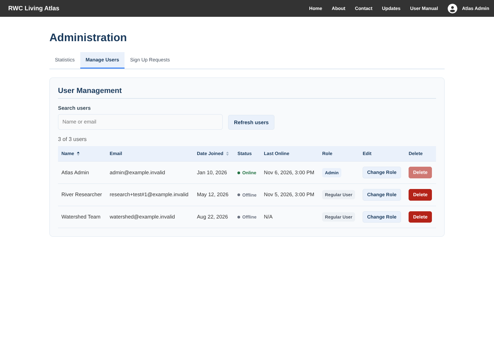
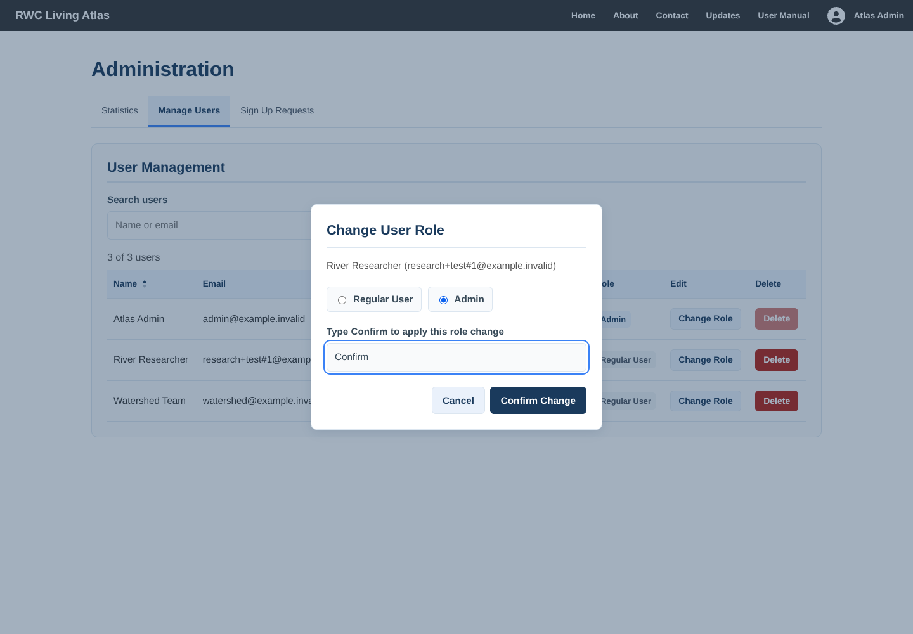
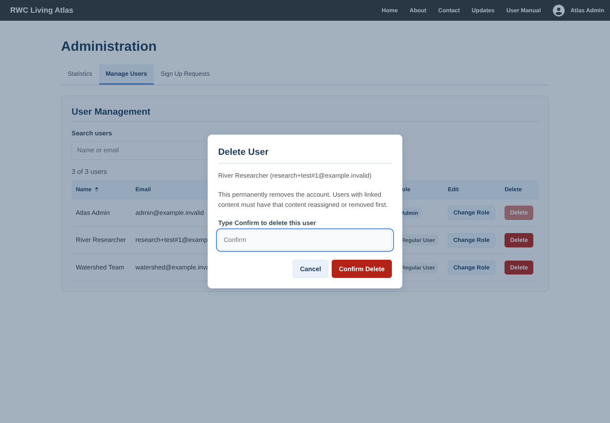
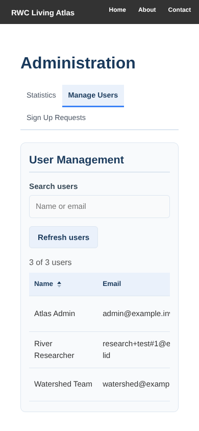
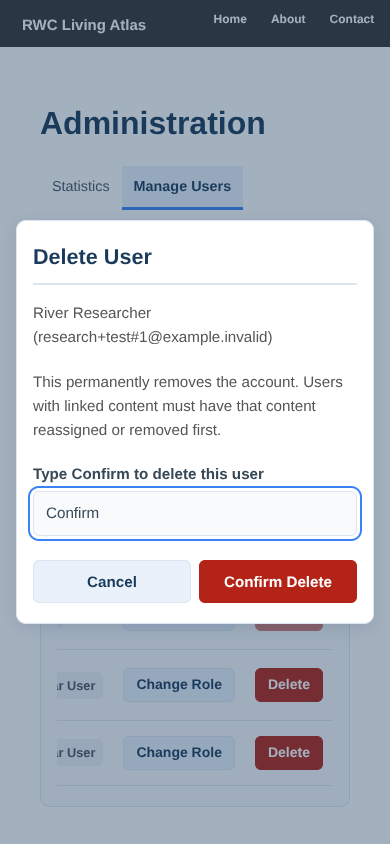

# User Management verification

The dashboard restores stored login state before evaluating protected routes. Manage Users opens by default and includes search, refresh, counts, loading/error states, and keyboard-accessible sorting. Role changes and deletions keep failures visible, prevent duplicate submissions, update successful results immediately, and use accessible confirmation dialogs.

Management APIs use independent transactions with rollback and return HTTP errors for missing users, protected admins, linked content, and database failures. Concurrent role changes cannot remove the last admin. A current user's role change also updates their browser session.

## Validation

- Frontend regression: 31 suites / 214 tests passed, including 13 new auth and management cases.
- Backend offline regression: 67 tests passed, including 11 new management API cases.
- Isolated PostgreSQL 17: 5 integration tests passed, including persisted role changes, concurrent demotions, deletion conflicts, and transaction recovery.
- Repository helper regressions: 30 tests passed.
- Manual export contracts and production build passed (existing lint warnings).
- Chromium checks using the production bundle and synthetic API responses: reload remains on `/administration`; promote/demote updates the selected row; Enter submits; Escape cancels and restores focus; deletion encodes special email characters; a 390px viewport keeps the admin panel within the viewport and scrolls the table horizontally; dialogs remain usable; no page errors.

The browser checks use synthetic `example.invalid` users and intercept remote requests. Database checks use a separate disposable local PostgreSQL cluster. No production accounts or services are used. Screenshots document the desktop list, both dialogs, and mobile layout; the existing global navigation is outside this change.

## Screenshots







## Operations

No migrations, new dependencies, or environment changes. Deploy frontend and backend together to receive the updated HTTP error contracts. User deletion preserves existing foreign-key constraints: linked content must be reassigned or removed first. Existing login and API authorization architecture is unchanged.

## Filter and sort verification

Tested November 24, 2026 on `codex/admin-user-filters` at `03aca3a`, based on `main` at `d2eb37e`. The custom joined-date range includes both selected calendar dates in the browser's time zone. Last sign-in presets use rolling 24-hour periods.

- The Administration suite adds cases for combined search and filters, both endpoints of a custom joined-date range, applying and cancelling narrow-screen filter changes, and two-way sign-in sorting with missing or invalid timestamps at the bottom.
- The browser check uses Chrome 157, Playwright 1.59, five synthetic accounts, and a fixed clock in `America/Los_Angeles`. The sandbox denied the initial loopback navigation. The rerun fulfils production bundle assets, roster and role-change requests through browser routes and blocks other requests. There are no test database records to clean up.
- Browser widths of 1440, 881, 390, and 320 pixels cover the inline controls, the transition to the compact controls, and the narrow filter dialog. The workflow covers invalid dates, refresh with filters applied, Escape and focus restoration, and a role change that removes a user from the filtered results. The first run exposed the last flow losing focus. The page now returns focus to search when the row that opened the dialog disappears.
- The local browser script and screenshots are under `LivingAtlas1-main/client/coverage/output/playwright/` in the feature worktree. The earlier screenshots above show the previous layout.

From the client directory in the feature worktree, the Jest run used Node.js 24.22.3 and a loopback application programming interface (API) URL. The first run passed 37 suites. Two suites failed during import because the default transform exception covered Axios. Allowing Tiptap TypeScript and vendor CSS resolved the import failures. The rerun passed all 39 suites and 262 tests in 134.446 seconds, including 11 User Management tests.

```powershell
$env:CI = 'true'
$env:REACT_APP_API_URL = 'http://localhost:8000'
node ./node_modules/react-scripts/scripts/test.js --watchAll=false --runInBand --silent --testMatch '**/.worktrees/**/src/**/*.test.js' --transformIgnorePatterns 'node_modules[\\/](?!(axios|@tiptap)[\\/]|.+\.css$)'
```

Manual export passed with 21 chapters and 348 blocks. The production bundle compiled with the existing lint and card CSS warnings. The user management source passed ESLint.

## Online status verification

The second version starts from `main` at `d4043f6` and was verified at feature commit `8125396`. Visible signed-in tabs send a heartbeat every 45 seconds. PostgreSQL uses server time to check whether any valid session for the user has a heartbeat within 120 seconds. The roster keeps a durable record of whether an account has ever sent a heartbeat. This lets it report Offline after expiry or logout and Unknown before the first heartbeat. Heartbeats leave the Last sign-in timestamp to the existing sign-in flow.

- The heartbeat accepts a verified session for the current account. The roster still requires server-verified administrator privileges. Password reset tokens cannot send a heartbeat. Logout revokes its token through the existing session endpoint. Other valid sessions can keep the account online.
- The visible Manage Users tab polls every 30 seconds. A poll updates presence on the current roster without replaying local edits or bringing deleted rows back. Tests cover authorization, unavailable status and recovery, and keyboard focus when a filtered row disappears.
- The database schema adds two columns. Existing accounts and tokens start without recorded presence. The previous frontend can consume the new roster response, and rolling back the feature does not require dropping columns.

Local verification on November 24, 2026

- The frontend run passed 42 suites and 277 tests in 120.574 seconds with the Jest options above and Node.js 24.22.3. The Administration suite has 15 tests, and the heartbeat hook has four. The manual exported 21 chapters and 349 blocks. The production bundle compiled with the existing warnings.
- Chrome 157 and Playwright 1.59 exercised the built app at 1440, 390, and 320 pixels with four synthetic accounts and mocked requests. The first browser attempt checked for an authorization header on every API request, including public routes. Restricting that assertion to the roster and heartbeat routes let the rerun verify both requests, automatic status updates, polling failure and recovery, mobile Apply and Cancel, and Last sign-in filtering and sorting. Browser logs and screenshots are under `LivingAtlas1-main/client/coverage/output/playwright/` in the feature worktree.
- The offline backend suite passed 86 tests in 6.116 seconds on Python 3.12.12, including 19 user-management tests. The first sandboxed run stalled while Python opened a local socket pair. The same offline suite passed outside the sandbox.
- The two presence and password recovery cases in `scripts/check_ci_postgres.py` passed through the FastAPI routes against PostgreSQL 17.6 at `127.0.0.1:5433/livingatlas_test`. The local port was already in use by the test service, so the probe used two connection-local temporary tables and applied the new migration twice. The first probe exposed a mock that lost its mail patch when the account module was reimported. Keeping the imported module in the probe let both cases pass. The probe confirmed zero fixture rows before rollback and that the temporary tables were gone afterward.
