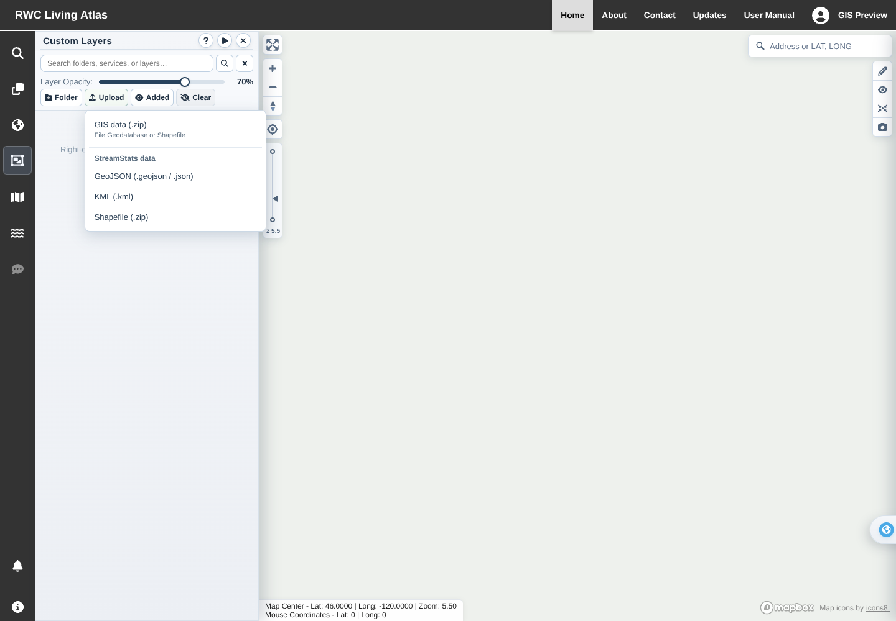
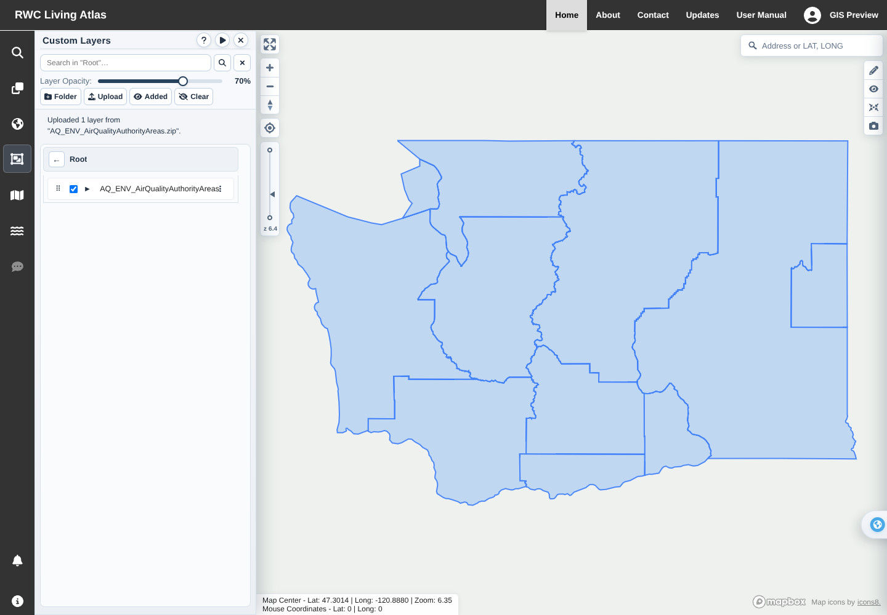
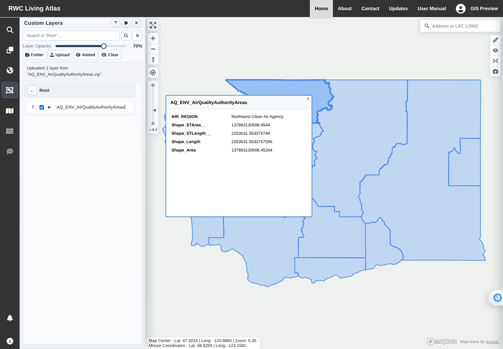
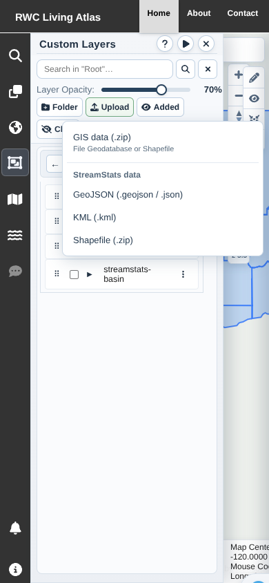

# GIS archives and StreamStats uploads in Custom Layers

Upload now opens an anchored, keyboard-accessible menu beside the button:

- **GIS data (.zip):** zipped File Geodatabase (`.gdb` directory) or Shapefile.
- **StreamStats data:** GeoJSON (`.geojson`/`.json`), KML (`.kml`), or Shapefile ZIP.

Choosing a format opens its corresponding file picker. The menu stays inside
the viewport, closes on outside click/Escape, and restores keyboard focus.
Uploads show progress, prevent duplicate submissions, and keep actionable
conversion/save failures visible. Each spatial feature class is saved as a
separate custom layer in the selected folder, checked on immediately, and
zoomed into view. Attributes, multipart polygons and holes are retained.
Partial save failures report how many layers were already saved.

## GIS conversion

`POST /arcgis/custom-layers/import-gis` accepts a multipart `file`. Fiona's
bundled GDAL/PROJ reads File Geodatabases and Shapefiles and converts their CRS
to WGS84 longitude/latitude. Temporary archives are deleted after conversion;
original archives are not retained or uploaded to third-party GIS hosting.
Converted GeoJSON uses the existing per-account custom-layer save/read API and
PostgreSQL storage. The converter itself does not write to the database.

ZIPs are read through GDAL's virtual ZIP filesystem without extracting paths.
Entry paths, duplicates, encryption, compression, CRC and expanded size are
validated before native parsing. Projection data is required. Conversion is
bounded to one active request per process, returning a retryable 429 when busy.
Limits: 25 MiB archive, 100 MiB expanded contents, 2,000 entries, 20 spatial
layers, 100,000 features, 2 million coordinate pairs and 20 MiB converted JSON.
Non-spatial/empty layers and features without geometry are reported as notices.
Shapefiles need matching `.shp`, `.shx`, `.dbf`, and `.prj` files.

StreamStats KML import now keeps complete MultiGeometry contents (including
basin polygons, holes and outlet points) rather than only the first point or
polygon. GeoJSON accepts UTF-8 BOMs and rejects empty/non-geographic data.
Uploaded-feature popups choose an anchor automatically and fit small viewports,
so edge clicks do not hide the title and close button.

## Verification

- Frontend full regression: **37 suites / 242 tests passed**. Focused regressions
  for the final popup/BOM fixes also passed (8 tests).
- Backend offline regression: **77 tests passed**, including 10 real GDAL tests
  using synthetic temporary File Geodatabases and Shapefiles.
- Isolated PostgreSQL 17 integration: **6 tests passed**, including conversion,
  account save, lazy GeoJSON fetch, and exact geometry/attribute round trip.
- Repository helper regressions: **30 tests passed**.
- Data/manual export contracts: **5 checks passed**.
- Production build and **146 offline manual screenshots passed**, with existing
  lint warnings; `pip check` passed.
- Chromium: real production bundle + real local conversion endpoint + real
  WebGL. The user's attached `AQ_ENV_AirQualityAuthorityAreas.zip` contains one
  File Geodatabase feature class, `Air_Quality_Authority_Areas`: **10 MultiPolygon
  features in EPSG:2927**. Verified actual multipart upload, WGS84 conversion,
  automatic map display, `AIR_REGION` attribute popup, and restoration after
  reload. Also exercised all three StreamStats format options, a rejected
  invalid ZIP, menu positioning, mobile bounds, and Escape/focus restoration.

Browser verification uses synthetic account metadata, an in-memory mock of the
existing library persistence API, and a neutral offline basemap. Conversion and
rendered GIS geometry are real. Database persistence is separately verified
against a disposable local PostgreSQL cluster. No production accounts or
services are mutated. The original uploaded archive is **not committed**.

## Screenshots

## Release

Deploy frontend and backend together. The backend adds the pinned
`Fiona==1.10.1` dependency; its standard binary wheel includes GDAL/PROJ and the
OpenFileGDB driver, so no separate system GDAL installation is required on the
supported Linux/Python 3.12 deployment. No schema migrations, new service keys,
new storage accounts, or GIS hosting setup. Include `tests.test_gis_import` in
offline regression runs; it is already part of Engineering CI.
