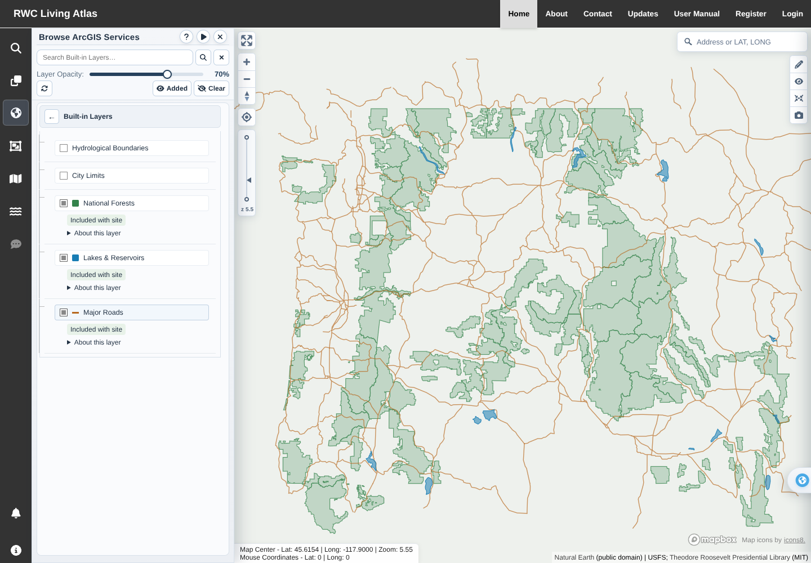
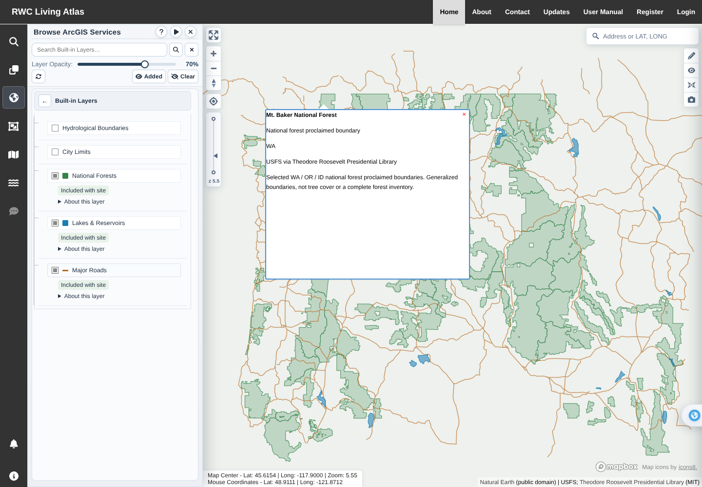
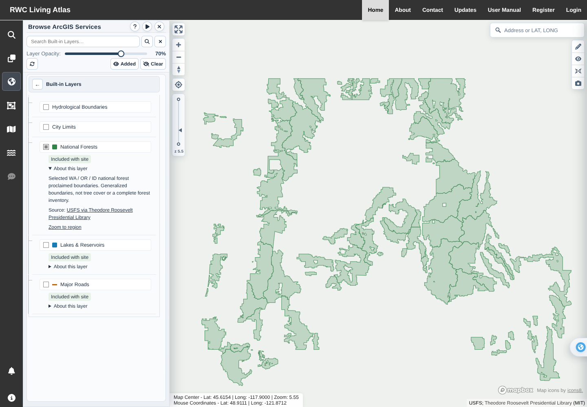
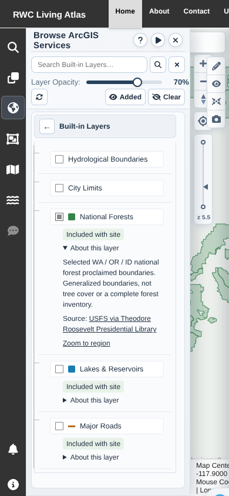

# Local built-in layers verification

Added **National Forests**, **Lakes & Reservoirs**, and **Major Roads** to
Built-in Layers. The three snapshots ship in the client and are fetched from
`/data/builtin-layers/` only when selected. No new GIS hosting account, API key,
backend route, database schema, package dependency, or external runtime data
request is needed. Existing basemaps and the two legacy Mapbox built-ins retain
their existing sources.

## Data

- 36 selected proclaimed national forest boundaries, from USFS geometry via the
  Theodore Roosevelt Presidential Library's licensed, simplified collection.
  These are boundaries, **not tree-canopy coverage** or a complete current
  administrative-forest inventory.
- 14 major lakes/reservoirs and 352 road features from public-domain Natural
  Earth 1:10 million data.
- All three cover the WA/OR/ID region and border areas. Whole intersecting
  features are retained; they are not clipped to state borders. About 395 KB of
  GeoJSON is committed, with attribution, licenses and file checksums.
- See the [snapshot provenance and refresh instructions](../../../LivingAtlas1-main/client/public/data/builtin-layers/README.md).

The shared catalog drives default visibility, panel rows, and legacy visibility
mapping. A map-scoped controller owns on-demand requests, cached data, safe
text popups, error/retry state, opacity, and restoration after style changes.
Search respects the built-in folder scope and includes built-in results in
navigation counts. Added and Clear include the new categories.

## Validation

- `CI=true npm test -- --watchAll=false --runInBand`: **33 suites, 226 tests passed**.
  Twelve new cases cover lazy loading, cached re-enable, pending deselection,
  unavailable/malformed data and retry, repeated style reloads, cleanup, safe
  popup text, opacity, panel selection/clear/Added, error UI, search counts, and
  isolation from external ArcGIS services.
- `node --test scripts/builtin-layers/data.test.cjs scripts/export-manual.test.cjs`:
  **5 checks passed**, including real snapshot geometry, unique feature IDs,
  checksums, license files, byte limits and manual export contracts.
- `CI=false npm run build`: **passed** with existing lint warnings; generated
  all 146 offline manual screenshots. Snapshot generation is not a build step.
- Chromium production-bundle check: **passed** using real WebGL and the actual
  committed GeoJSON files. Verified no data request before selection; only
  same-origin snapshot requests; a deliberately injected lake HTTP 503 and
  successful Retry; visible rendered geometry for all three categories;
  repeated style restoration without refetching; opacity; an actual feature
  click and popup; search count; Clear; cached re-enable; mobile viewport;
  and no page errors.

Browser checks replace remote basemaps with a neutral offline style and mock
unrelated backend/catalog responses. The polygons and roads in these images
are actual rendered snapshot data, not synthetic geometries. No production
accounts, uploads, or database writes are used.

## Screenshots

## Operations

Deploy the client, including its public data directory. No other deployment
configuration is required. Snapshot updates are explicit and pinned; use
`python scripts/builtin-layers/generate.py`, inspect data/license changes, run
the snapshot tests, and commit the regenerated files. Runtime and standard
builds use the committed data and never fetch from upstream providers.
