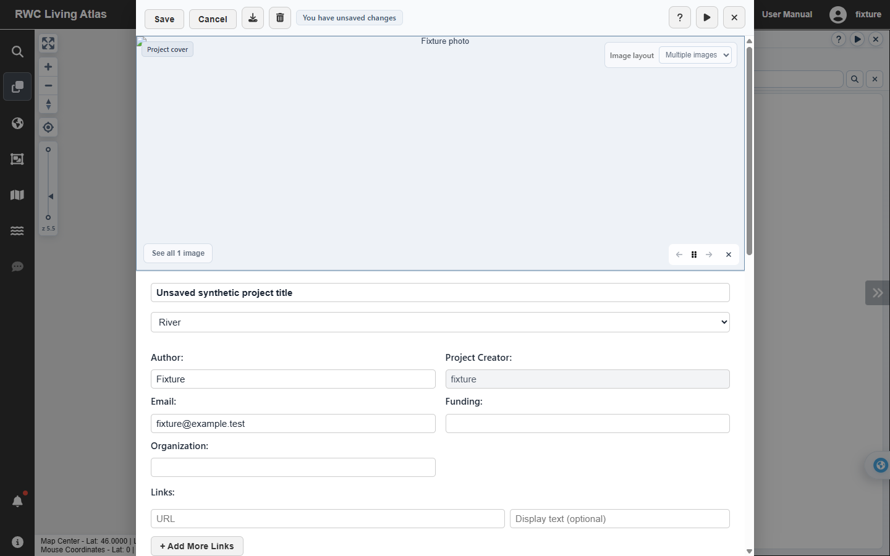
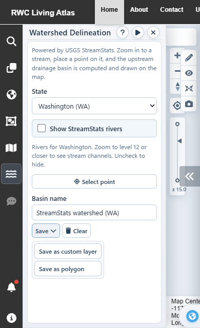

# UI review screenshots - 2026-10-18

These screenshots were captured from the local development app in a separate,
temporary Chrome profile. API, map and StreamStats requests were intercepted;
all project/account data and coordinates are synthetic. No data was saved.
The UI sources match commit 23210b3; merging main afterward did not change them.

## Project detail toolbar

The unsaved-changes notice follows Delete. Help, Tutorial and Close use the
Projects panel icons and share the neutral button style. The fixture image
request is intentionally stubbed; this capture verifies the toolbar and form.

## Compact watershed Save menu

At a 390px viewport, both original save choices remain visible. The menu follows
the longest label instead of filling the panel. At 390px and 1242px, its measured
width was about 141px, with no menu or panel-body horizontal overflow.

